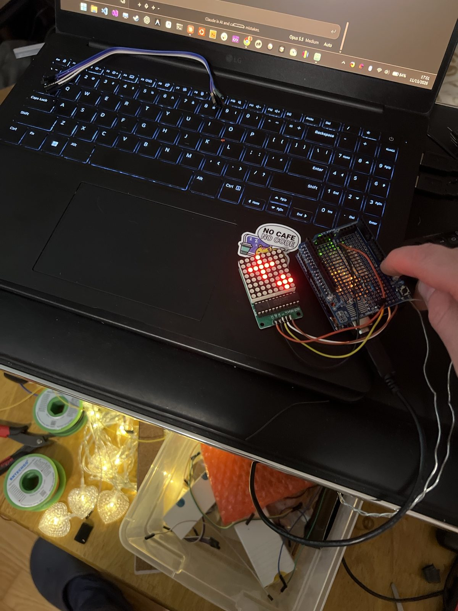

# String Lights Controller

A West & Arrow battery string light (originally 3xAA, single slide switch) converted to a hardwired, Arduino-controlled light with effects, a button, an 8x8 LED icon display, power-loss memory, and IR remote support.

## What it does

- Runs from USB or a 9 V barrel adapter. No more batteries.
- 8 effects: solid, breathe, twinkle, candle, pulse (heartbeat), blink, wave, sunrise (30 s fade-in).
- Dimming and speed control (PWM through a 2N2222 low-side switch).
- **Power-cycle mode:** every power-up turns the lights on at full brightness on the next effect.
- **S1 button** on the proto shield: short press = on/off, long press = next effect.
- **8x8 MAX7219 matrix** shows an icon for the current effect, a bar graph when brightness/speed changes, and a single dot in standby.
- **EEPROM memory:** on/off, effect, brightness and speed survive power cuts.
- **IR remote** (21-key NEC kit remote) is mapped in firmware. The kit receiver turned out to be faulty, so this is waiting on a replacement 1838 receiver.
- **Serial control** at 9600 baud for a future Home Assistant bridge.
- 3D-printed PETG case: base, lid with matrix window, and a plunger for S1.

## Repo layout

| Path | What |
|---|---|
| [firmware/string_lights/](firmware/string_lights/string_lights.ino) | Current firmware (v2.4). This is what's flashed. |
| [firmware/ir_test/](firmware/ir_test/ir_test.ino) | Library-free IR receiver test sketch |
| [firmware/archive/](firmware/archive/) | Every earlier firmware version from the build |
| [hardware/case/](hardware/case/) | Case generators (`uno_case.py` v1, `uno_case_v2.py` v2), STLs and sliced gcode per version |
| [docs/wiring.md](docs/wiring.md) | Final schematic, pin map, wire colors |
| [docs/bom.md](docs/bom.md) | Parts list |
| [docs/firmware.md](docs/firmware.md) | Controls, settings, serial commands, version history |
| [docs/case.md](docs/case.md) | Case design, print settings, assembly |
| [docs/build-log.md](docs/build-log.md) | Full chronological log of the 2026-11-15 build |
| [docs/troubleshooting.md](docs/troubleshooting.md) | Every problem hit and how it was resolved |
| [docs/ir-receiver.md](docs/ir-receiver.md) | IR receiver investigation and replacement plan |
| [docs/adr/](docs/adr/) | Design decisions |
| [docs/gallery.md](docs/gallery.md) | All 70 build photos with captions |
| [tools/check_sketch.sh](tools/check_sketch.sh) | Host-side syntax check of the firmware (no board needed) |

## Quick start

1. Install Arduino IDE 2.x (`winget install ArduinoSA.IDE.stable`).
2. Library Manager: install **IRremote** (Armin Joachimsmeyer) and **LedControl** (Eberhard Fahle).
3. Open `firmware/string_lights/string_lights.ino`, select **Arduino Uno** and the board's COM port, upload.
4. Wire it per [docs/wiring.md](docs/wiring.md).

## Status

| Area | State |
|---|---|
| Electronics | Done, soldered on the proto shield, tested |
| Firmware v2.4 | Flashed and verified (effects, button, matrix orientation, memory) |
| IR | Code ready; needs a replacement receiver |
| Case | v1 printed and in use (glued). v2 (heat-set inserts, plugs, USB fix) designed and reviewed; base sliced, lid waits on 3 matrix measurements |
| Home Assistant | Not started (serial bridge planned) |

## License

Apache License 2.0. See [LICENSE](LICENSE) and [NOTICE](NOTICE).
