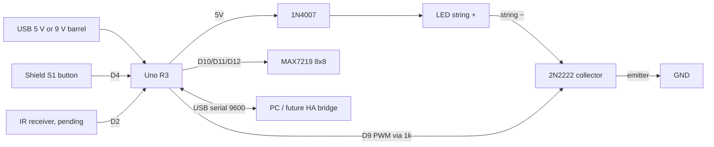

# Architecture

## System Overview

A single Arduino Uno R3 drives a two-wire LED string through a low-side transistor switch, reads one button (and optionally an IR receiver), shows state on an 8x8 LED matrix, and keeps its state in EEPROM. There is no network. A parametric Python model generates the printed enclosure.

## Component Diagram

## Data Flow

Inputs (serial line, IR frame, button edge) become actions (`setLights`, `setEffect`, `setBrightness`, `setSpeed`). Every action calls `changed()`, which prints status, marks the matrix dirty and schedules an EEPROM save after 3 s of quiet. Each `loop()` pass computes the effect level from `millis()`, scales by brightness, applies the gamma curve and writes PWM on D9; the matrix redraws only when dirty. On boot, state loads from EEPROM, then (with `CYCLE_ON_POWERUP`) advances one effect and saves immediately.

## Key Technologies

- **Firmware**: Arduino C++ on ATmega328P, IRremote, LedControl, EEPROM.
- **Hardware**: Uno R3 clone, prototype shield v5, 2N2222, 1N4007, MAX7219 (HW-109).
- **Enclosure**: Python (manifold3d, trimesh), PrusaSlicer, PETG on a FlashForge Adventurer 5M Pro (ZMOD Klipper).

## Repository Structure

- `firmware/string_lights/`: current firmware. `firmware/archive/`: every earlier version. `firmware/ir_test/`: library-free IR diagnostic.
- `hardware/case/`: case generators (v1, v2), STLs and sliced gcode per version.
- `tests/`: automated checks and stub Arduino headers.
- `docs/`: build log, wiring, firmware, case, ADRs, photos, governance docs.
- `constitution/`: Eric's Engineering Constitution (submodule).

## Layer Boundaries

Not declared. The only importable code is the single-file case generator and the tests; there are no layers to enforce. Revisit if the firmware is split into modules (TODO, Refactoring).

## Decisions

See `docs/adr/`: 0002 transistor switch, 0003 MAX7219 display, 0004 power-cycle stepping.
